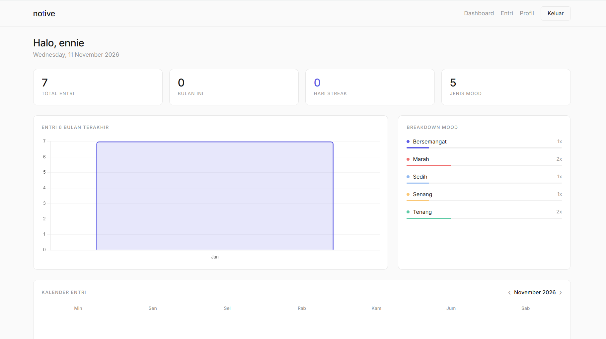
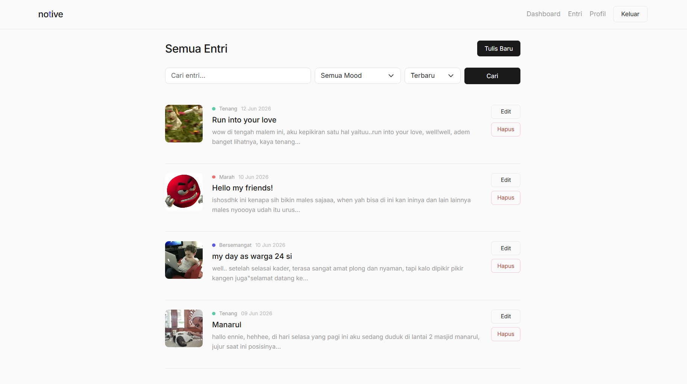
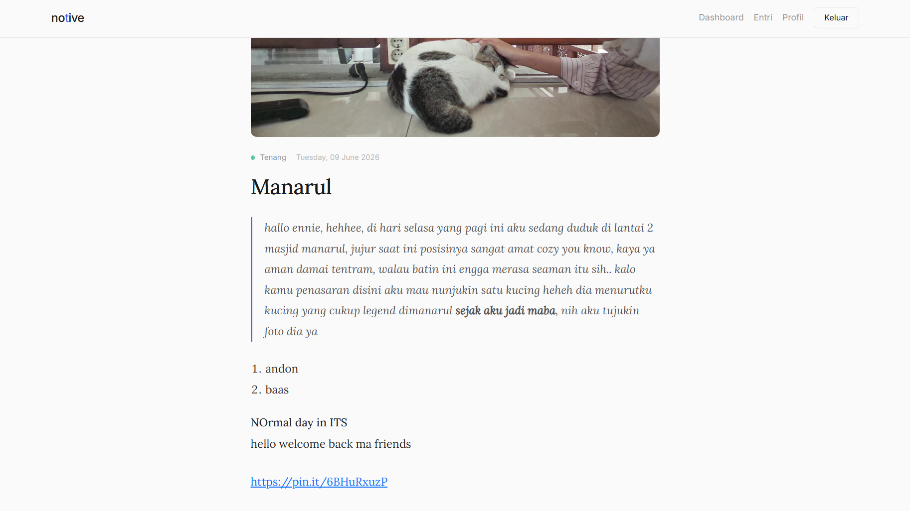
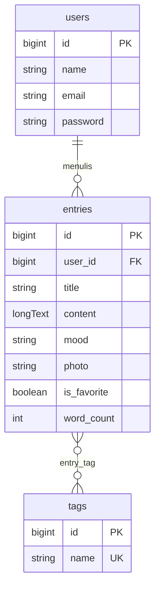

# Notive

**Notive** adalah aplikasi jurnal harian pribadi berbasis web. Pengguna dapat menulis entri dengan editor teks kaya, melampirkan foto, mencatat mood, memberi tag, lalu melihat statistik menulis (streak, mood bulanan, kalender) di dashboard. Setiap entri bersifat privat dan hanya bisa diakses oleh pemiliknya.



## Fitur

**Akun**
- Registrasi, login, logout, reset password, dan pengaturan profil (autentikasi Laravel Breeze).

**Entri jurnal**
- Tambah, lihat, ubah, dan hapus entri (CRUD).
- Editor teks kaya (Quill) dengan unggah gambar langsung di dalam isi entri.
- Foto sampul per entri (JPG, PNG, WebP, maksimal 2 MB).
- Mood per entri: Tenang, Senang, Bersemangat, Lelah, Sedih, Marah.
- Tag bebas (otomatis dibuat dan dipakai ulang antar entri).
- Pencarian pada judul dan isi, filter mood, tag, dan tanggal, serta pengurutan (terbaru, terlama, judul) dengan paginasi.

**Dashboard**
- Total entri dan jumlah entri bulan ini.
- Streak menulis harian.
- Grafik distribusi mood dan grafik jumlah entri 6 bulan terakhir (Chart.js).
- Kalender bulanan dengan penanda tanggal yang memiliki entri; klik tanggal untuk membuka entri hari itu.
- Lima entri terbaru.

**Privasi**
- Setiap entri hanya dapat dibuka, diubah, atau dihapus oleh pemiliknya (pengguna lain mendapat respons 403).

## Tampilan

| Daftar Entri | Tulis Entri |
|---|---|
|  |  |

## Teknologi

| Bagian | Teknologi |
|---|---|
| Backend | PHP 8.2+, Laravel 12 |
| Database | MySQL / MariaDB |
| Autentikasi | Laravel Breeze |
| Frontend | Blade, Bootstrap 5, Tabler Icons |
| Editor dan grafik | Quill 2, Chart.js |
| Lingkungan lokal | XAMPP (Apache, MySQL, phpMyAdmin) |

## Skema Database



Tabel `entry_tag` adalah tabel pivot dengan primary key gabungan (`entry_id`, `tag_id`). Entri ikut terhapus jika penggunanya dihapus (`ON DELETE CASCADE`).

## Cara Menjalankan (Lokal dengan XAMPP)

**Prasyarat**
- [XAMPP](https://www.apachefriends.org/) dengan PHP 8.2 atau lebih baru
- [Composer](https://getcomposer.org/)
- Koneksi internet (Bootstrap, Quill, dan Chart.js dimuat dari CDN)

**Langkah**

1. **Nyalakan MySQL (dan Apache) di XAMPP Control Panel.** Klik *Start* pada modul **MySQL**. Modul **Apache** diperlukan agar phpMyAdmin bisa dibuka. Kalau MySQL belum menyala, aplikasi akan menampilkan error `Connection refused` ke `127.0.0.1:3306`.

2. **Buat database.** Buka `http://localhost/phpmyadmin`, pilih *New*, lalu buat database bernama `notive` dengan collation `utf8mb4_unicode_ci`.

3. **Clone dan pasang dependensi.**
   ```bash
   git clone <url-repo-ini>
   cd notive
   composer install
   ```

4. **Siapkan file environment.**
   ```bash
   cp .env.example .env
   php artisan key:generate
   ```
   Lalu buka `.env` dan pastikan koneksi database mengarah ke MySQL:
   ```env
   DB_CONNECTION=mysql
   DB_HOST=127.0.0.1
   DB_PORT=3306
   DB_DATABASE=notive
   DB_USERNAME=root
   DB_PASSWORD=
   ```
   (Password `root` kosong adalah pengaturan bawaan XAMPP.)

5. **Buat tabel dan tautan penyimpanan foto.**
   ```bash
   php artisan migrate
   php artisan storage:link
   ```
   Perintah `storage:link` diperlukan agar foto yang diunggah bisa ditampilkan di browser.

6. **(Opsional) Isi data demo.**
   ```bash
   php artisan db:seed --class=DemoSeeder
   ```
   Perintah ini membuat akun `demo@notive.test` (password `password`) beserta 16 entri contoh dengan mood dan tag beragam, sehingga dashboard dan kalender langsung terisi. Kamu juga bisa mendaftar akun sendiri lewat halaman register.

7. **Jalankan aplikasi.**
   ```bash
   php artisan serve
   ```
   Buka `http://127.0.0.1:8000`.

> Aplikasi **membutuhkan MySQL/MariaDB**. Dashboard memakai fungsi SQL seperti `MONTH()` dan `YEAR()` yang tidak tersedia di SQLite.

## Struktur Proyek

```
notive/
├── app/
│   ├── Http/Controllers/    # EntryController, DashboardController, ProfileController, Auth/
│   └── Models/              # User, Entry, Tag
├── database/
│   ├── migrations/          # users, entries, tags, entry_tag, kolom tambahan entries
│   └── seeders/             # DemoSeeder (data contoh)
├── docs/screenshots/        # tangkapan layar untuk README
├── resources/views/         # welcome, about, dashboard, entries/, profile/, auth/
├── routes/web.php           # route aplikasi
└── storage/app/public/      # foto yang diunggah (tidak ikut di-commit)
```

## Rute Utama

| Method | URL | Fungsi |
|---|---|---|
| GET | `/` | Halaman utama |
| GET | `/about` | Tentang Notive |
| GET | `/dashboard` | Dashboard statistik |
| GET/POST | `/entries` | Daftar dan tambah entri |
| GET/PUT/DELETE | `/entries/{entry}` | Lihat, ubah, hapus entri |
| POST | `/entries/upload-image` | Unggah gambar dari editor |
| GET/PATCH/DELETE | `/profile` | Kelola profil |

Semua rute selain `/` dan `/about` memerlukan login.

## Rencana Pengembangan

- Fitur entri favorit dan penghitung jumlah kata (kolom `is_favorite` dan `word_count` sudah disiapkan di database).

## Lisensi

Dibangun di atas [Laravel](https://laravel.com), yang berlisensi MIT.
